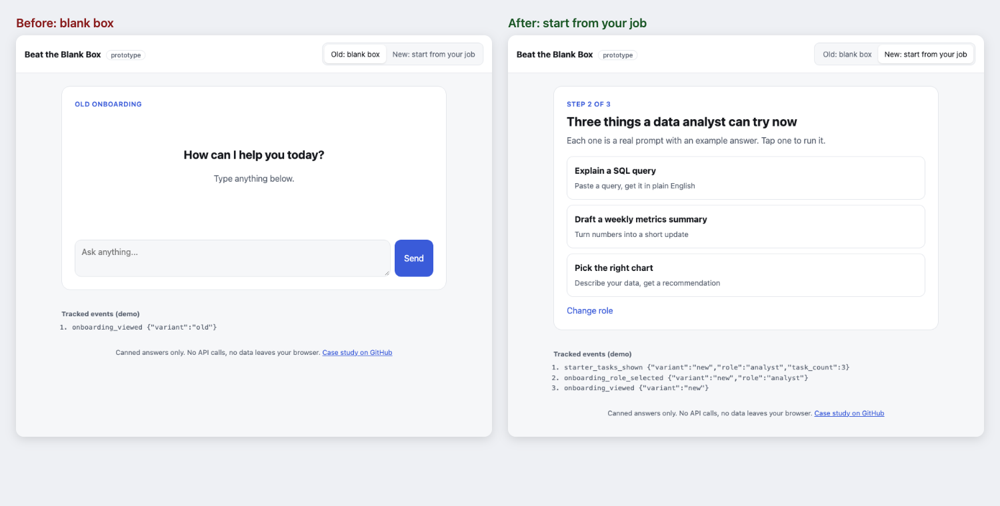

# Beat the Blank Box — turn "what do I ask?" into a first win in under a minute

> **PM case study + working prototype** · AI chat onboarding · No user data yet (research and A/B test are planned, not run)

**▶ [Live demo](https://akhilesh360.github.io/beat-the-blank-box/)** · **🎬 [60-second walkthrough](docs/demo.webm)** · [Demo script](docs/demo-script.md)

## How it works

## 1. User and problem
**Who:** first-week users of a general AI chat app who signed up to get work done (analysts, PMs, marketers, students, engineers, recruiters), not AI enthusiasts.

**Problem:** the first screen is an empty box. Users who don't know what the tool is good at send one vague message, get a vague answer, and leave. The loss happens in session one, before any feature can help.

Working insight (an assumption to test, not a finding): people know their *job* better than they know what to *ask*. The [interview guide](docs/interview-guide.md) is how I'd validate it.

## 2. Product goal
Every new user gets one useful, job-relevant answer in their first minute, so they have a reason to come back.

## 3. Solution and trade-offs
**Built:** pick your role (one tap, 6 roles) → see 3 starter tasks for that role, each a ready prompt → run one and get the answer in the normal chat, with the other two as chips. The free-text box stays visible. A toggle in the prototype compares it with the old blank box.

| Decision | Why | Trade-off |
|---|---|---|
| Ask for role, not goal | "What do you do?" is easier to answer than "What do you want?" | Unusual jobs get a generic set; needs an "Other" path |
| Exactly 3 tasks | Shows range without creating a new choice problem | Choosing the right 3 per role becomes ongoing work |
| Buttons, not free-text role | Faster, and gives clean data for analysis | Less precise than parsing a job title |
| Keep the chat box visible | Starter tasks are a ramp, not a replacement | Some users will skip them |

**Not building:** long tutorials or product tours (skipped, and they delay the first answer); a big prompt library (recreates the blank box); personalisation from history (new users have none).

## 4. North Star metric
**Day-7 retention:** % of new users who send at least one message on any of days 1–7 after signup. It measures lasting value; first-session clicks would rise trivially and prove little.

## 5. Supporting metrics
- **Adoption:** % of treatment users who select a role and click a starter task in session one.
- **Engagement:** starter tasks completed per user in session one (`task_completed`).
- **Retention:** day-1 and day-14 retention, to check the day-7 effect isn't novelty.
- **Conversion:** median time from `onboarding_viewed` to `first_message_sent`.

## 6. Guardrail metrics
- **Onboarding drop-off** (view onboarding, never reach chat): under 10%.
- **Typed messages per user, days 0–7:** not down more than 5% (tasks must not replace exploring).
- **Thumbs-down rate on first answer:** no significant increase.
- **First-response latency and error rate:** no regression.

Thresholds are proposals to agree with the team before launch.

## 7. Prioritization
This came first because it is high reach (every new user), sits at the step with the largest loss (first session), and is low effort (a screen and curated content, no model changes).
Alternatives considered: a product tour (low effort, but users skip tours); better answers to vague prompts (high effort, model work); re-engagement emails (only reach users who already left).

## 8. Experiment and learning
**Test:** 50/50 A/B on new accounts, blank box vs role-based onboarding. Two-proportion z-test on day-7 retention, alpha 0.05, power 0.8. Full plan and 9-event tracking spec: [docs/experiment.md](docs/experiment.md).

**Sample size** ([scripts/sample_size.py](scripts/sample_size.py)), using an **assumed** 20% baseline and 5,000 sign-ups/day: a 2-point lift needs 6,510 users per arm (13,020 total), about 3 days to enrol plus 7 to read. A 1-point lift needs 25,583 per arm.

**Decision rule:** ship if day-7 retention is significantly higher and no guardrail crosses its threshold. Flat result: check adoption first. If few users clicked tasks, fix the tasks before dropping the idea.

**What this repo shows:** a working prototype with canned answers and a live panel showing the tracking events firing. No user data or test results yet.

| Before: blank box | After: start from your job | Mobile |
|---|---|---|
|  |  |  |

**Next (30/60/90):** 8–10 interviews to choose tasks per role → ship behind a flag and run the test → if it wins, add "Other" and more roles, and rotate tasks toward the ones that drive return visits.

---
**How to run it** · open `docs/index.html` in a browser (no build, no keys) · deep links `?variant=old`, `?role=analyst&task=0` · `python3 scripts/sample_size.py --baseline 0.20 --mde 0.02 --daily-users 5000` · GitHub Pages: deploy `main`, folder `/docs`

**About** — Built by Sai Akhilesh Veldi. [Portfolio](#) · [LinkedIn](https://www.linkedin.com/in/akhileshsai/)
