# Beat the Blank Box: turn "what do I ask?" into a first win in under a minute

> **PM case study + working prototype** · AI chat onboarding · Problem sized on 29,446 real conversations (WildChat-1M); A/B test planned, not run

**▶ 60-second demo (plays automatically)**

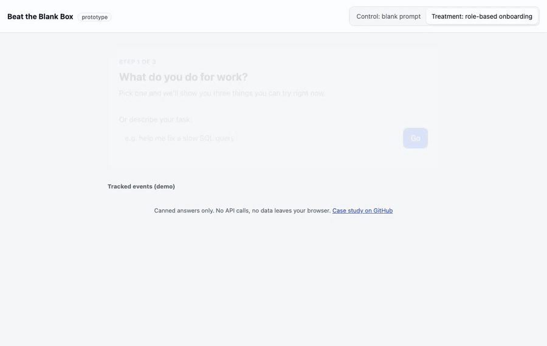

**Live demo: [akhilesh360.github.io/beat-the-blank-box](https://akhilesh360.github.io/beat-the-blank-box/)**

## How it works

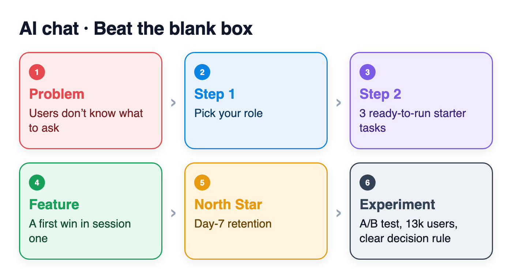

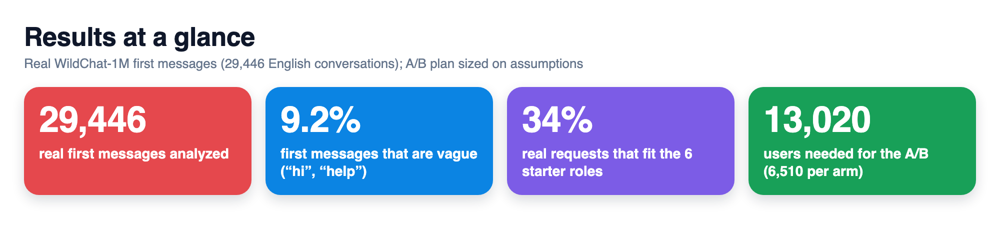

### Data

| Component | Dataset | Source / owner | License | Size used | Real or simulated |
|---|---|---|---|---|---|
| First-message analysis (section 1) | [WildChat-1M](https://huggingface.co/datasets/allenai/WildChat-1M), shard 0 of 14 | Allen Institute for AI (Zhao et al., 2024) | ODC-BY | 29,446 English conversations, 2023-04-09 to 2023-05-04 | Real |
| Topic mix and classifier check (sections 7, 8) | Same shard, random sample | Hand-labelled by the author | Labels: MIT (repo) | 180 first messages | Real |
| Classifier training phrases | [docs/intent_train.js](docs/intent_train.js) | Written by the author | MIT | 120 phrases | Hand-written |
| A/B results (section 8) | [scripts/simulate_events.py](scripts/simulate_events.py) | Generated | n/a | 13,020 users | Simulated |

Raw shards are not committed. The repo holds only derived numbers ([data/wildchat_summary.json](data/wildchat_summary.json)), the labels ([data/wildchat_labels.csv](data/wildchat_labels.csv)) and a 2,000-message sample of short, non-toxic, PII-screened first messages ([data/wildchat_first_messages_sample.csv](data/wildchat_first_messages_sample.csv)). Reproduce with `scripts/wildchat_analysis.py`.

## 1. User and problem
**Who:** first-week users of a general AI chat app who signed up to get work done (analysts, PMs, marketers, students, engineers, recruiters), not AI enthusiasts.

**Problem:** the first screen is an empty box. Users who don't know what the tool is good at open with something vague and have to spend turns getting to a task, or leave. The loss happens in session one, before any feature can help.

**Evidence (WildChat, 29,446 real English conversations):**
- **9.2%** of first messages are vague (rule: under 6 words, or a generic opener such as "hi", "help", "can you help me"; 2.2% are a bare opener). Another 13.7% are only 6 to 10 words.
- **6.1%** of a hand-labelled random sample (11 of 180) contain no task at all ("hi", "How are you?", "index_flag").
- Median first message is 37 words, but the spread is wide (25th percentile 11, 75th percentile 142): one group pastes a full brief, another types a fragment.
- **53.8%** of conversations end after one turn. Vague openers end after one turn *less* often (29.3% vs 56.3% for specific ones, z = -27): a "hi" forces a second turn just to state the task. One-turn is not the same as churn here; long pasted prompts often get what they need in one reply.

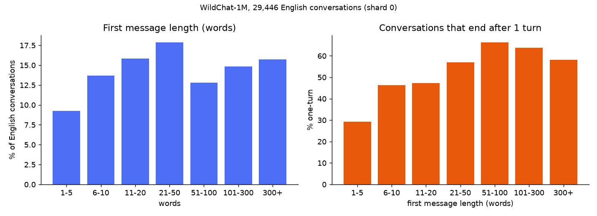

What the data does and does not show: it shows vague openers are common and cost the user an extra round trip. It cannot show retention, because WildChat has no account-level return data; day-7 retention still needs the A/B test.

Working insight (an assumption to test, not a finding): people know their *job* better than they know what to *ask*. The [interview guide](docs/interview-guide.md) is how I'd validate it.

## 2. Product goal
Every new user gets one useful, job-relevant answer in their first minute, so they have a reason to come back.

## 3. Solution and trade-offs
**Built:** pick your role (one tap, 6 roles) → see 3 starter tasks for that role, each a ready prompt → run one and get the answer in the normal chat, with the other two as chips. The free-text box stays visible. A toggle in the prototype compares it with the old blank box.

**Typed instead of tapped?** If a user types a goal on the role screen ("help me fix a slow SQL query"), a small on-page naive Bayes classifier ([docs/intent.js](docs/intent.js)) guesses the role and says so: "Looks like you're a data analyst (83% confident), here are 3 tasks." Below 40% confidence it asks the user to pick. It is trained on about 20 hand-written phrases per role plus a keyword list ([docs/intent_train.js](docs/intent_train.js)), not on user data. Leave-one-out accuracy on those 120 phrases is **80.8%** (38.3% without the keyword list); run `node scripts/eval_intent.js`. The keyword list was written by the same person as the phrases, so treat this as an optimistic sanity check. Real-world accuracy is in section 8.

| Decision | Why | Trade-off |
|---|---|---|
| Ask for role, not goal | "What do you do?" is easier to answer than "What do you want?" | Unusual jobs get a generic set; needs an "Other" path |
| Exactly 3 tasks | Shows range without creating a new choice problem | Choosing the right 3 per role becomes ongoing work |
| Buttons first, typed role as a fallback | Taps are fast and give clean data; the classifier catches users who type anyway | A wrong guess costs a tap on "Change role"; logged with `source` and `confidence` |
| Keep the chat box visible | Starter tasks are a ramp, not a replacement | Some users will skip them |

**Not building:** long tutorials or product tours (skipped, and they delay the first answer); a big prompt library (recreates the blank box); personalisation from history (new users have none).

## 4. North Star metric

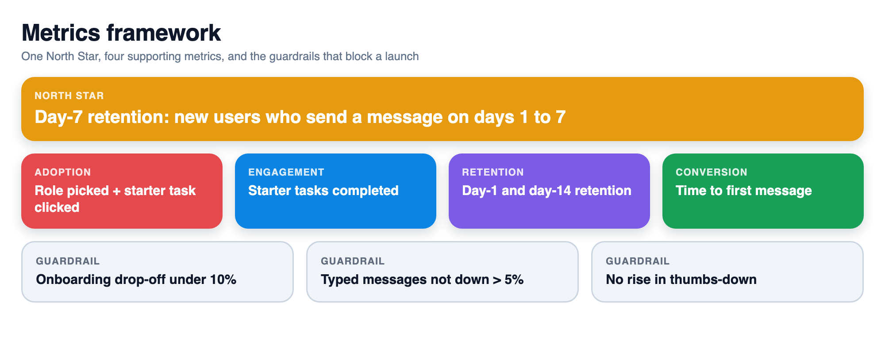

**Day-7 retention:** % of new users who send at least one message on any of days 1–7 after signup. It measures lasting value; first-session clicks would rise trivially and prove little.

## 5. Supporting metrics
- **Adoption:** % of treatment users who select a role and click a starter task in session one.
- **Engagement:** starter tasks completed per user in session one (`task_completed`).
- **Retention:** day-1 and day-14 retention, to check the day-7 effect isn't novelty.
- **Conversion:** median time from `onboarding_viewed` to `first_message_sent`.

## 6. Guardrail metrics
- **Onboarding drop-off** (view onboarding, never reach chat): under 10%.
- **Typed messages per user, days 0–7:** not down more than 5% (tasks must not replace exploring).
- **Thumbs-down rate on first answer:** no significant increase.
- **First-response latency and error rate:** no regression.

Thresholds are proposals to agree with the team before launch.

## 7. Prioritization
This came first because it is high reach (every new user), sits at the step with the largest loss (first session), and is low effort (a screen and curated content, no model changes).

**What people actually ask first** (180 hand-labelled WildChat first messages): creative writing and role-play 26.7%, coding 13.9%, homework and study 13.3%, general knowledge 11.7%, non-fiction writing and editing 11.1%, advice and other 7.8%, greeting with no task 6.1%, marketing and content 4.4%, jailbreak or agent prompts 3.3%, data and analysis 1.7%. Mapped to the prototype's roles, only 34% of messages (61 of 180) fit one: engineer 25, student 25, marketer 8, analyst 3, PM 0, recruiter 0.

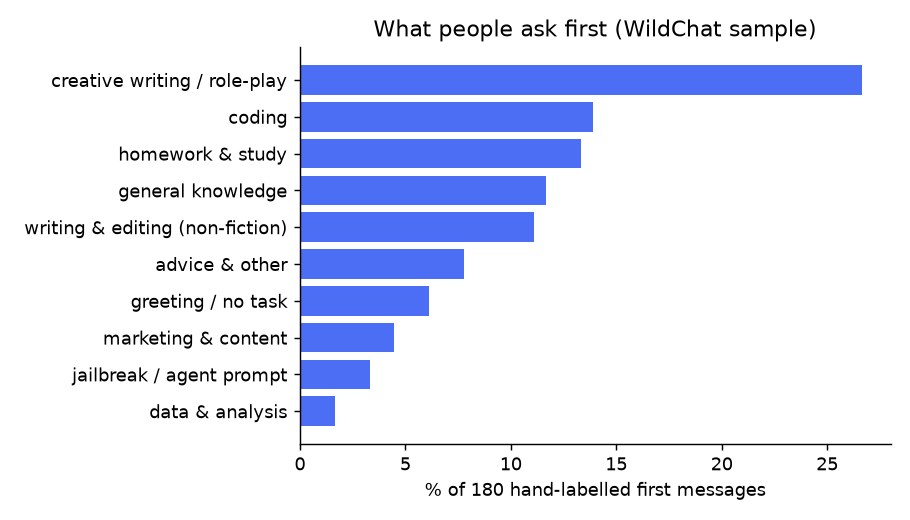

Implications for the starter tasks: lead with **writer / creative**, **developer** and **student** sets, add a **"just curious / ask anything"** path for knowledge questions, and demote PM and recruiter to an "Other" list until there is evidence of demand. Caveat: WildChat users chose a free, anonymous chatbot in 2023, so they skew toward hobby and student use; a work-focused product's sign-ups will differ, which the interviews should check.
The typed-intent classifier was added second and kept small (no model, about 100 lines) because it only rescues users who skip the buttons.
Alternatives considered: a product tour (low effort, but users skip tours); better answers to vague prompts (high effort, model work); re-engagement emails (only reach users who already left).

## 8. Experiment and learning

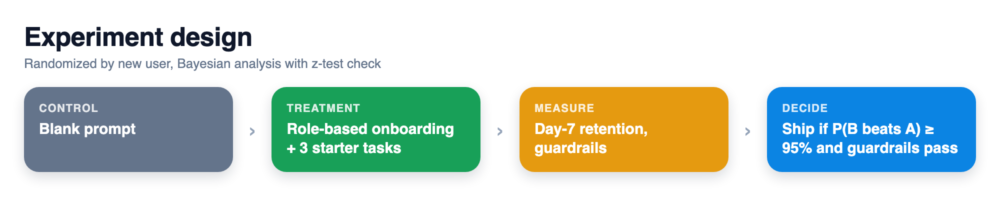

**Test:** 50/50 A/B on new accounts, blank box vs role-based onboarding. Two-proportion z-test on day-7 retention, alpha 0.05, power 0.8. Full plan and 9-event tracking spec: [docs/experiment.md](docs/experiment.md).

**Sample size** ([scripts/sample_size.py](scripts/sample_size.py)), using an **assumed** 20% baseline and 5,000 sign-ups/day: a 2-point lift needs 6,510 users per arm (13,020 total), about 3 days to enrol plus 7 to read. A 1-point lift needs 25,583 per arm.

**Analysis, made concrete (simulation, no real users):** [scripts/analyze_ab.py](scripts/analyze_ab.py) reads an events CSV in the experiment.md schema and reports day-7 retention per arm two ways: a Bayesian Beta-Binomial posterior (P(B>A), expected lift, 95% credible interval) and the planned z-test, then checks the three guardrails. To test the pipeline, [scripts/simulate_events.py](scripts/simulate_events.py) generates **simulated** events with an assumed 20% vs 22% retention. On 13,020 simulated users: P(B>A) = 0.979, expected lift +7.4% relative (95% CrI +0.2% to +14.9%), z-test p = 0.042, all guardrails pass. These numbers only show the code works; they say nothing about real users.

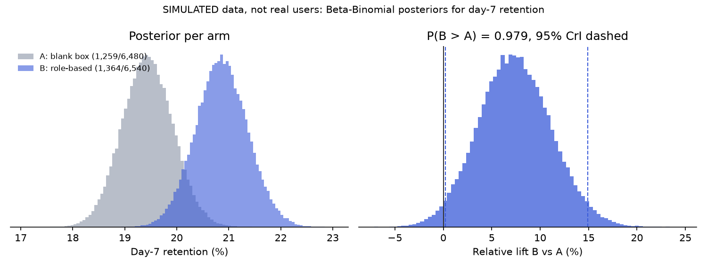

**Classifier on real messages** ([scripts/eval_intent_wildchat.js](scripts/eval_intent_wildchat.js), 180 hand-labelled WildChat first messages): the 80.8% in-sample figure does not hold.
- Of the 61 messages that belong to one of the 6 roles, the classifier commits (confidence of 40% or more) on 52.5% and is right on 40.6% of those: **21.3% end to end**. Student recall is 3 of 25 and engineer 7 of 25; real messages are long, pasted code or text, not short role phrases.
- Of the 119 messages that fit no role, it still commits to a role on **48.7%**, because it has no "none" class.
- What to fix: add an "other" class trained on real negatives; retrain on real labelled first messages instead of hand-written phrases; cap input length or classify only the first sentence; add writer and "ask anything" roles so the label set matches demand. Until then, keep the buttons as the primary path, which the design already does.

**Decision rule:** ship if day-7 retention is significantly higher and no guardrail crosses its threshold. Flat result: check adoption first. If few users clicked tasks, fix the tasks before dropping the idea.

**What this repo shows:** a working prototype with canned answers and a live panel showing the tracking events firing. No user data or test results yet.

| Before: blank box | After: start from your job | Mobile |
|---|---|---|
| 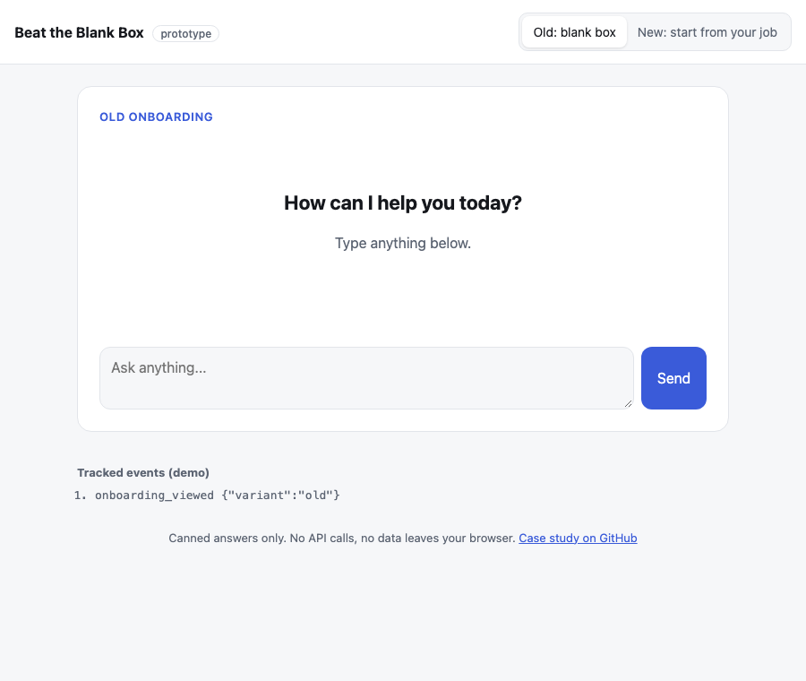 | 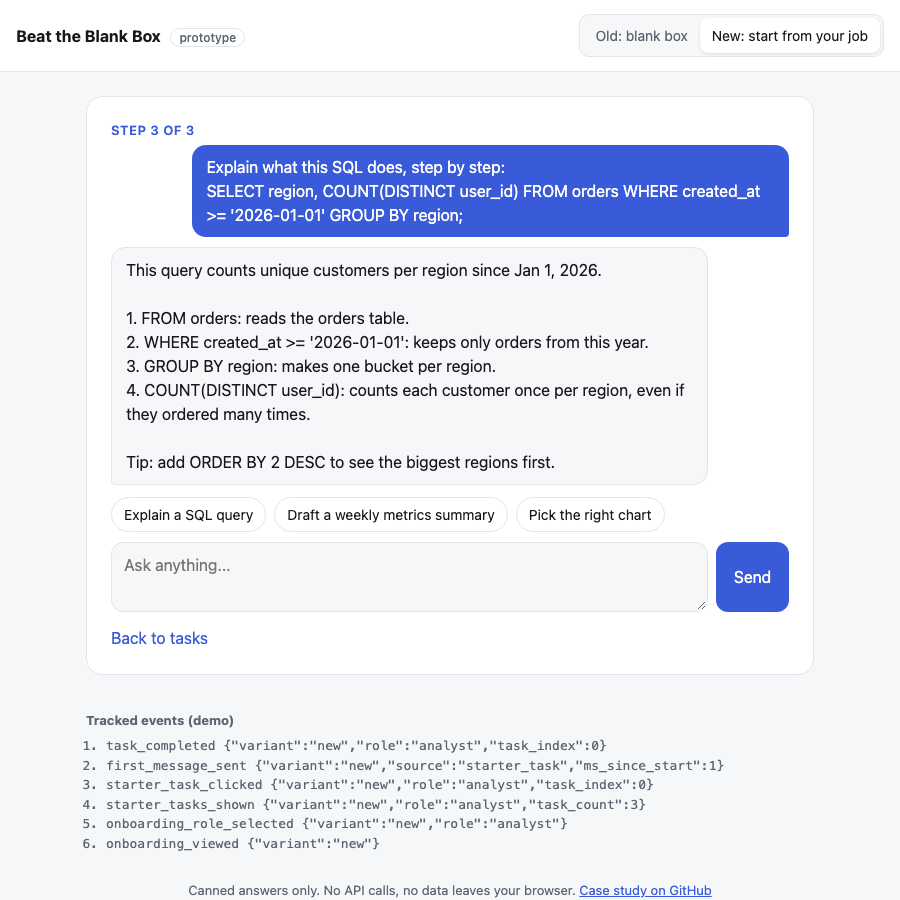 | 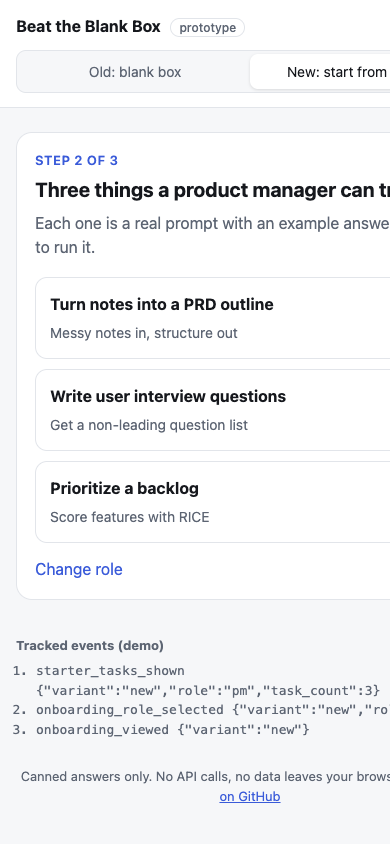 |

**Next (30/60/90):** re-cut the role list using the topic mix above, then 8–10 interviews to choose tasks per role → ship behind a flag and run the test → if it wins, add "Other" and more roles, and rotate tasks toward the ones that drive return visits.

---
**How to run it** · open `docs/index.html` in a browser (no build, no keys) · deep links `?variant=old`, `?role=analyst&task=0` · `python3 scripts/sample_size.py --baseline 0.20 --mde 0.02 --daily-users 5000` · `node scripts/eval_intent.js` · `python3 scripts/simulate_events.py --out data/simulated_events.csv && python3 scripts/analyze_ab.py data/simulated_events.csv` (add `--plot docs/ab_posterior.png` with matplotlib) · real data: `python3 -m venv .venv && .venv/bin/pip install pandas pyarrow matplotlib`, download a shard into `data/raw/` (see the script header), then `.venv/bin/python scripts/wildchat_analysis.py extract && .venv/bin/python scripts/wildchat_analysis.py analyze` · GitHub Pages: deploy `main`, folder `/docs`

**Data credit:** WildChat-1M, Allen Institute for AI, ODC-BY. Zhao, W., Ren, X., Hessel, J., Cardie, C., Choi, Y., and Deng, Y. (2024). *WildChat: 1M ChatGPT Interaction Logs in the Wild.* ICLR 2024. [arXiv:2405.01470](https://arxiv.org/abs/2405.01470)

